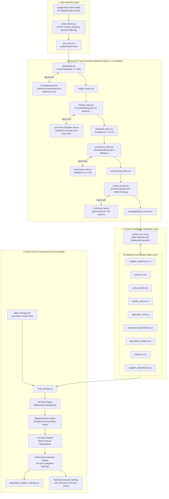
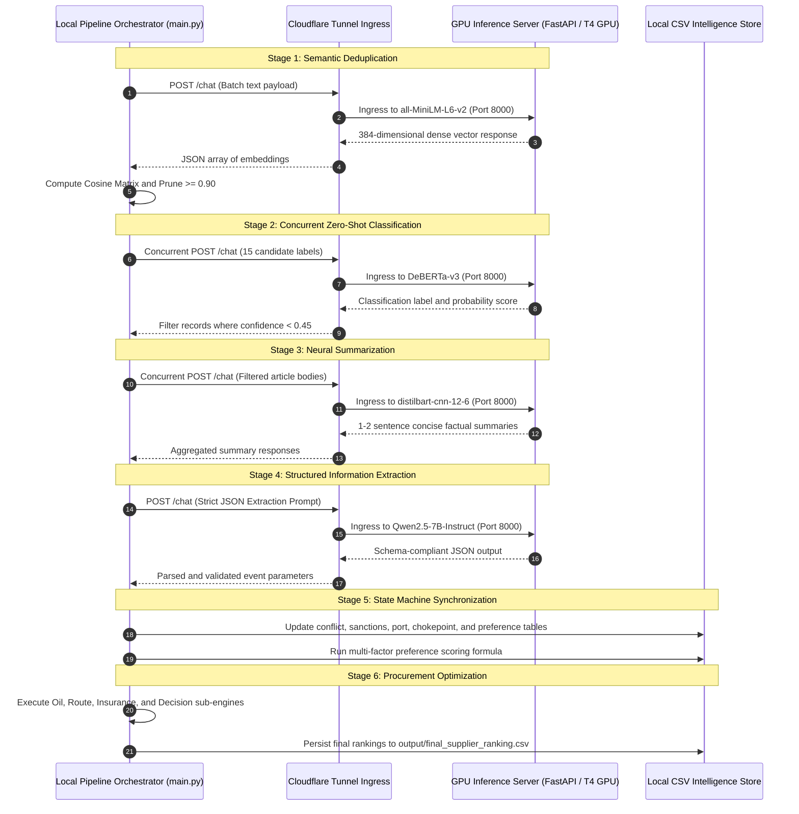
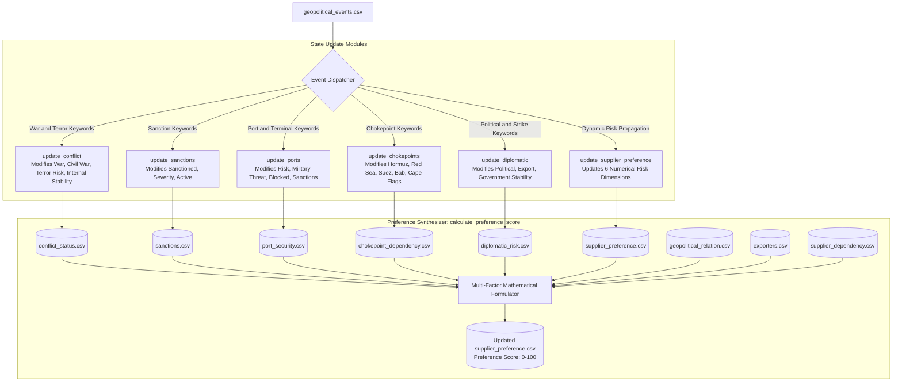
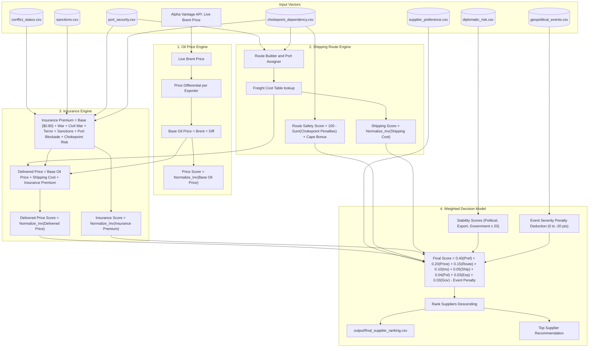
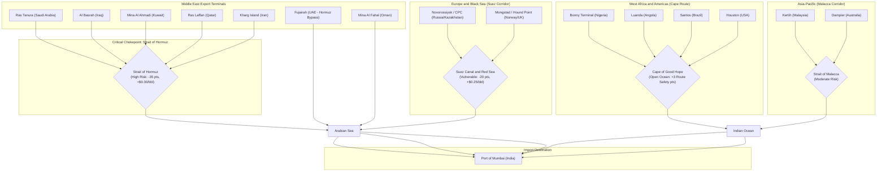

# System Architecture: AI-Driven Energy Supply Chain Resilience

## 1. Architectural Overview and Hybrid Cloud Topology

The AI-Driven Energy Supply Chain Resilience system is architected as an asynchronous, hybrid-cloud decision intelligence platform. It bridges continuous, high-frequency unstructured geopolitical news streams with a deterministic multi-criteria mathematical decision engine to optimize crude oil procurement routes for import-dependent nations.

To achieve enterprise-grade neural processing while maintaining a zero-marginal-cost operating model, the architecture strictly decouples heavy deep learning inference from local deterministic business logic:
- Cloud GPU Inference Tier: Free Google Colab T4 GPU runtime workers host four distinct transformer models exposed via FastAPI web services and secured behind Cloudflare Tunnels.
- Local Orchestration Tier: A lightweight local Python runtime executes RSS feed ingestion, concurrent network polling, dense matrix similarity pruning, relational database state machine transitions, and multi-criteria decision optimization.



---

## 2. Distributed Client-Server Infrastructure and Sequence Architecture

Network communication between the local orchestrator and the remote GPU workers relies on Cloudflare Tunnel ingress tunnels. This eliminates the need for public IP addresses, port forwarding, or fee-based hosting subscriptions.



---

## 3. NLP Pipeline and Data Flow Architecture

The natural language processing pipeline systematically refines noisy open-source RSS web documents into high-value structured geopolitical crisis vectors.

```mermaid
flowchart LR
    subgraph S1 [Phase 1: Ingestion]
        A[RSS Feed URLs] -->|feedparser| B[HTML Stripping
BeautifulSoup]
        B -->|Regex Normalization| C[Keyword Filter
27 Energy Terms]
        C -->|raw_news.csv| D[Raw Articles]
    end

    subgraph S2 [Phase 2: Deduplication]
        D -->|Vector Generation| E[all-MiniLM-L6-v2]
        E -->|Cosine Similarity Matrix| F{Score >= 0.90?}
        F -->|Yes| G[Keep Longest Article]
        F -->|No| H[Retain Both]
        G & H -->|unique_news.csv| I[Deduplicated Stream]
    end

    subgraph S3 [Phase 3: Classification]
        I -->|Parallel Workers: 10| J[DeBERTa-v3 Classifier]
        J -->|15 Geopolitical Classes| K{Confidence >= 0.45?}
        K -->|No| L[Discard Noise]
        K -->|Yes| M[classified_news.csv]
    end

    subgraph S4 [Phase 4: Summarization]
        M -->|Parallel Workers: 6| N[distilbart-cnn-12-6]
        N -->|Factual Compression| O[summarized_news.csv]
    end

    subgraph S5 [Phase 5: Extraction]
        O -->|System Prompt Template| P[Qwen2.5-7B-Instruct]
        P -->|Regex Sanitization| Q[JSON Validation Engine]
        Q -->|geopolitical_events.csv| R[Structured Event Stream]
    end

    S1 --> S2 --> S3 --> S4 --> S5
```



### Event Extraction JSON Data Contract

The interface between the unstructured news summarizer and `Qwen 2.5-7B-Instruct` enforces a strict JSON schema:

```json
{
  "country": "Iran",
  "actor": "IRGC Navy",
  "event_type": "Shipping Attack",
  "severity": 4,
  "political_risk": 4,
  "export_risk": 5,
  "india_affected": true,
  "affected_exporters": ["Iraq", "Kuwait", "Saudi Arabia", "UAE", "Qatar"],
  "affected_ports": ["Kharg Island", "Ras Tanura", "Al Basrah"],
  "affected_chokepoints": ["Strait of Hormuz"],
  "sanction": false,
  "reason": "IRGC intercepted commercial tanker transiting the Strait of Hormuz citing maritime safety inspections."
}
```

---

## 4. Geopolitical State Machine and Knowledge Graph Architecture

When structured events are output by `extract_events.py`, the state machine engine in `update_all_csv.py` propagates risk adjustments across the permanent database layer.



### State Machine Transition Rules

1. Conflict State Transitions:
- War token detected in event text sets War = Yes.
- Civil token detected sets Civil War = Yes.
- Severity >= 8 sets Internal Stability = Very Low and Terror Risk = Very High.
- Severity >= 6 sets Internal Stability = Low and Terror Risk = High.
- Severity >= 4 sets Internal Stability = Medium and Terror Risk = Medium.

2. Sanction State Transitions:
- Sanction token detected sets Sanctioned = Yes and Active = Yes.
- Severity mapped to Low, Medium, High, or Very High.

3. Port and Terminal Security Transitions:
- Attack, missile, drone, or naval tokens referencing recognized ports elevate Risk and Military Threat levels.
- Blocked or closure tokens set Blocked = Yes.

4. Chokepoint Dependency Mapping:
- Incidents detected in Hormuz, Red Sea, Suez, Bab-el-Mandeb, or Cape Route set corresponding waterway risk flags to Yes.

5. Dynamic Preference Score Synthesis Formula:
The composite preference score for each supplier is computed using the multi-factor formulation:

```
Preference Score = clamp(
    (Base x 0.7)
    + Relation Bonus
    + Spare Capacity Bonus
    + Import Share Bonus
    + Core Exporter Bonus
    + Diversification Bonus
    + Resilience Bonus
    + Special Geopolitical Adjustment
    - (Political Risk x 0.5)
    - (Sanction Risk x 1.5)
    - (Conflict Risk x 0.8)
    - (Port Risk x 0.1)
    - (Chokepoint Risk x 0.1)
    - Chokepoint Penalty
    - Event Penalty,
    0,
    100
)
```

Where:
- Base = Baseline Export Stability from supplier_preference.csv
- Relation Bonus = (Relation with India - 75) x 0.5
- Spare Capacity Bonus = Available spare capacity in mbpd x 6
- Import Share Bonus = India import percentage x 0.2
- Core Exporter Bonus = 15 points for High volume suppliers, 10 points for Medium volume, 3 points for Low/Spot
- Resilience Bonus = +10 points if the exporter can partially bypass Hormuz (such as UAE via Fujairah)
- Diversification Bonus = +10 points if the route transits zero Middle Eastern chokepoints (such as Nigeria, Brazil)
- Special Geopolitical Adjustment = +8 points for UAE (Fujairah strategic bypass), +6 points for Nigeria, -15 points for Iraq (spot cancellation penalties)
- Chokepoint Penalty = -35 points for Hormuz transit, -5 points for Partial Hormuz, -20 points for Red Sea or Bab el-Mandeb transit, -10 points for Partial
- Event Penalty = Sum of severity penalties for active event keywords (such as cargo cancellations, military strikes, refinery damage)

---

## 5. Procurement Decision Engine Mathematical Formulation

The Procurement Decision Engine in `route_decider.py` implements an 8-criteria multi-attribute decision model (MADM) combining live spot crude benchmarks with maritime logistics and insurance pricing.



### Mathematical Specifications

#### 1. Route Safety Index
```
Route Safety = clamp(100 - (12 x H) - (10 x RS) - (8 x BM) - (6 x SZ) + (3 x CR), 0, 100)
```
Where:
- H: Hormuz transit (1.0 for Yes, 0.5 for Partial, 0.0 for No)
- RS: Red Sea transit (1.0 for Yes, 0.5 for Partial, 0.0 for No)
- BM: Bab-el-Mandeb transit (1.0 for Yes, 0.5 for Partial, 0.0 for No)
- SZ: Suez Canal transit (1.0 for Yes, 0.5 for Partial, 0.0 for No)
- CR: Cape of Good Hope open ocean transit (1.0 for Yes, 0.0 for No)

#### 2. Risk-Adjusted Insurance Premium
```
Insurance Premium ($/bbl) = Base Insurance (0.80) + C_war + C_civil + C_terror + C_sanction + C_port + C_choke
```
Where:
- Base Insurance = 0.80 dollars per barrel
- C_war = 0.60 dollars if active international war
- C_civil = 0.50 dollars if active civil war
- C_terror evaluates to 0.40 (Very High), 0.30 (High), 0.15 (Medium), 0.05 (Low), or 0.00 dollars
- C_sanction = 0.40 dollars if active sanctions exist
- C_port = 0.40 dollars for blocked port, 0.20 dollars for partially blocked port
- C_choke = (0.30 x H) + (0.25 x RS) + (0.25 x BM) + (0.20 x SZ)

#### 3. Total Delivered Price
```
Delivered Price ($/bbl) = Base Oil Price + Shipping Freight Cost + Insurance Premium
```

#### 4. Multi-Criteria Final Scoring Model
```
Final Score = (0.40 x Preference) + (0.20 x Delivered Price) + (0.15 x Route Safety) + (0.10 x Insurance) + (0.05 x Shipping) + (0.04 x Political) + (0.03 x Export) + (0.03 x Government) - Event Penalty
```

Immediate Event Severity Penalty Schedule:
- Maximum Event Severity >= 5: -20 points deduction
- Maximum Event Severity == 4: -15 points deduction
- Maximum Event Severity == 3: -8 points deduction
- Maximum Event Severity == 2: -4 points deduction
- Maximum Event Severity < 2: 0 points deduction

---

## 6. Maritime Logistics and Global Chokepoint Topology

The maritime logistics framework models global crude carrier transit lanes connecting export terminals across Africa, the Middle East, the Americas, Europe, and Asia-Pacific to the Port of Mumbai (Nhava Sheva / Jawahar Dweep terminal).



### Comprehensive Route and Terminal Mapping Catalog

| Country | Primary Export Terminal | Maritime Route Description | Freight Cost ($/bbl) | Chokepoints Encountered |
| :--- | :--- | :--- | :--- | :--- |
| UAE | Fujairah | Fujairah -> Arabian Sea -> Mumbai | $1.90 | None (Bypasses Hormuz) |
| Oman | Mina Al Fahal | Mina Al Fahal -> Arabian Sea -> Mumbai | $2.00 | None (Open Arabian Sea) |
| Kuwait | Mina Al Ahmadi | Mina Al Ahmadi -> Strait of Hormuz -> Arabian Sea -> Mumbai | $2.00 | Strait of Hormuz |
| Saudi Arabia | Ras Tanura | Ras Tanura -> Strait of Hormuz -> Arabian Sea -> Mumbai | $2.10 | Strait of Hormuz |
| Qatar | Ras Laffan | Ras Laffan -> Strait of Hormuz -> Arabian Sea -> Mumbai | $2.20 | Strait of Hormuz |
| Iraq | Al Basrah | Al Basrah -> Strait of Hormuz -> Arabian Sea -> Mumbai | $2.40 | Strait of Hormuz |
| Malaysia | Kertih | Kertih -> Strait of Malacca -> Mumbai | $3.50 | Strait of Malacca |
| Russia | Novorossiysk | Novorossiysk -> Bosphorus -> Suez -> Mumbai | $4.50 | Bosphorus, Suez Canal, Red Sea |
| Nigeria | Bonny Terminal | Bonny Terminal -> Cape of Good Hope -> Mumbai | $4.80 | Cape of Good Hope |
| Australia | Dampier | Dampier -> Indian Ocean -> Mumbai | $4.90 | Open Indian Ocean |
| Angola | Luanda | Luanda -> Cape of Good Hope -> Mumbai | $5.10 | Cape of Good Hope |
| Brazil | Santos | Santos -> Cape of Good Hope -> Mumbai | $6.00 | Cape of Good Hope |
| Norway | Mongstad | North Sea -> Gibraltar -> Suez -> Mumbai | $6.40 | Gibraltar, Suez, Bab el-Mandeb |
| Mexico | Cayo Arcas | Cayo Arcas -> Gulf of Mexico -> Cape of Good Hope -> Mumbai | $6.50 | Cape of Good Hope |
| Canada | Vancouver | Vancouver -> Pacific Ocean -> Mumbai | $6.80 | Open Pacific Ocean |
| United States | Houston | Houston -> Atlantic -> Cape of Good Hope -> Mumbai | $7.20 | Cape of Good Hope |

---

## 7. Relational Database Schema and Stateful Data Dictionary

The persistence tier stores dynamic and reference data across 10 tabular CSV files:

```
[geopolitical_events.csv] (Event Audit Log)
       |
       +---> [conflict_status.csv] (War, Civil War, Terror)
       +---> [sanctions.csv] (Trade Sanctions and Severity)
       +---> [port_security.csv] (Terminal Military Threats, Blockades)
       +---> [chokepoint_dependency.csv] (Maritime Chokepoint Transit Flags)
       +---> [diplomatic_risk.csv] (Governance and Political Stability)
       |
       v
[supplier_preference.csv] <--- [geopolitical_relation.csv]
       |                  <--- [exporters.csv]
       |                  <--- [supplier_dependency.csv]
       v
[route_decider.py]
       v
[output/final_supplier_ranking.csv]
```

### Table Definitions and Schema Constraints

1. `csv/geopolitical_events.csv`:
- Record Type: Append-only audit log
- Fields: country (String), actor (String), event_type (String), severity (Integer 0-5), political_risk (Integer 0-5), export_risk (Integer 0-5), india_affected (Boolean), affected_exporters (String), affected_ports (String), affected_chokepoints (String), sanction (Boolean), reason (String), title (String), published (String), link (String), summary (String)

2. `csv/supplier_preference.csv`:
- Record Type: Stateful supplier risk index
- Fields: Country (String Primary Key), Preference Score (Integer 0-100), Political Risk (Integer 0-100), Sanction Risk (Integer 0-100), Conflict Risk (Integer 0-100), Export Stability (Integer 0-100), Port Risk (Integer 0-100), Chokepoint Risk (Integer 0-100), Confidence (Float 0.0-1.0)

3. `csv/sanctions.csv`:
- Record Type: Sovereign trade restrictions
- Fields: Country (String Primary Key), Sanctioned (Yes/No), By Whom (String), Severity (Low/Medium/High/Very High), Active (Yes/No)

4. `csv/port_security.csv`:
- Record Type: Marine terminal security index
- Fields: Port (String Primary Key), Country (String), Risk (Low/Medium/High/Very High), Military Threat (Low/Medium/High/Very High), Blocked (Yes/Partial/No), Sanctions (Yes/No)

5. `csv/conflict_status.csv`:
- Record Type: Sovereign armed conflict index
- Fields: Country (String Primary Key), War (Yes/No), Civil War (Yes/No), Internal Stability (Very Low/Low/Medium/High), Terror Risk (Low/Medium/High/Very High)

6. `csv/diplomatic_risk.csv`:
- Record Type: Institutional stability metrics
- Fields: Country (String Primary Key), Political Stability (Very Low to High), Export Stability (Very Low to High), Government Stability (Very Low to High)

7. `csv/chokepoint_dependency.csv`:
- Record Type: Maritime transit topology
- Fields: Country (String Primary Key), Hormuz (Yes/Partial/No), Red Sea (Yes/Partial/No), Suez (Yes/Partial/No), Bab-el-Mandeb (Yes/Partial/No), Cape Route (Yes/No)

8. `csv/geopolitical_relation.csv`:
- Record Type: Diplomatic tie indices
- Fields: Country (String Primary Key), Relation with India (Integer 0-100), Relation with USA (Integer 0-100), Relation with Iran (Integer 0-100), Relation Score (Integer 0-100)

9. `csv/exporters.csv`:
- Record Type: Exporter baseline registry
- Fields: Country (String Primary Key), Export Capacity (Integer bpd), Production (Integer bpd), OPEC (Yes/No), OPEC Plus (Yes/No), Crude Grade (String), Current Export to India (High/Medium/Low/Spot), Strategic Notes (String)

10. `csv/supplier_dependency.csv`:
- Record Type: Import reliance and expansion potential
- Fields: Country (String Primary Key), India Import Percentage (Float), Can Increase Export (Yes/No), Spare Capacity (String mbpd)

---

## 8. Failure Handling and Resilience Mechanisms

| Subsystem | Failure Scenario | Automated Fallback and Recovery Mechanism |
| :--- | :--- | :--- |
| News Fetcher | RSS endpoint failure, timeout, or DNS resolution drop | Ingestion engine catches HTTP exceptions per feed and continues with remaining active endpoints |
| Vector Deduplication | Embedding server timeout or Cloudflare 502/504 gateway error | Fallback preserves original article order, skipping vector pruning to prevent pipeline stoppage |
| Classifier Server | Candidate label parsing error or low confidence scores | Articles failing the 0.45 threshold or generating non-standard labels are safely discarded as noise |
| Neural Summarizer | Summarizer worker exception or rate limiting | Full article body is truncated to the first 250 characters as a fallback brief |
| LLM Event Extraction | Generative LLM produces conversational text without strict JSON | Regular expression parser extracts content matching the JSON curly bracket pattern, stripping markdown fences |
| Oil Price Sub-Engine | Alpha Vantage API quota reached or connection failure | System automatically activates calibrated default Brent spot crude benchmark of 78.40 dollars per barrel |
| Route Decider | Unlisted country in manual port registry | Fallback assigns Direct Ocean Route, default shipping rate of 5.50 dollars, and baseline route safety of 70 |

---

## 9. System Performance, Concurrency, and Scalability

1. Multi-Threaded Model Querying:
- Zero-Shot Classifier: Uses ThreadPoolExecutor with 10 concurrent worker threads to dispatch batches to DeBERTa-v3, completing classification of 40 articles in under 35 seconds.
- Neural Summarizer: Employs ThreadPoolExecutor with 6 worker threads to feed DistilBART, balancing throughput against Colab T4 GPU VRAM saturation.

2. Context Window and Token Optimization:
- Deduplication prunes approximately 25% to 35% of redundant news feeds prior to GPU ingestion.
- Summarization reduces raw news article bodies (averaging 350 words) into compact 30-word summaries, reducing token usage by 91% for downstream Qwen 2.5-7B parsing.

3. Low Latency Local Deterministic Optimization:
- All relational state updates and multi-criteria mathematical evaluations execute locally within 1.2 seconds, ensuring instant decision output once neural extraction finishes.

---

## 10. Authors and Acknowledgments

Lead Developer:
- Dhruv Kajare

Team Members:
- Juhi Nale
- Neha Tarmale

Project Context:
Engineered for the INNOV8 3.0 Hackathon AI Geopolitical Decision Intelligence Initiative exploring autonomous neural intelligence pipelines, distributed zero-cost GPU inference, and multi-criteria mathematical optimization for national energy supply security.
