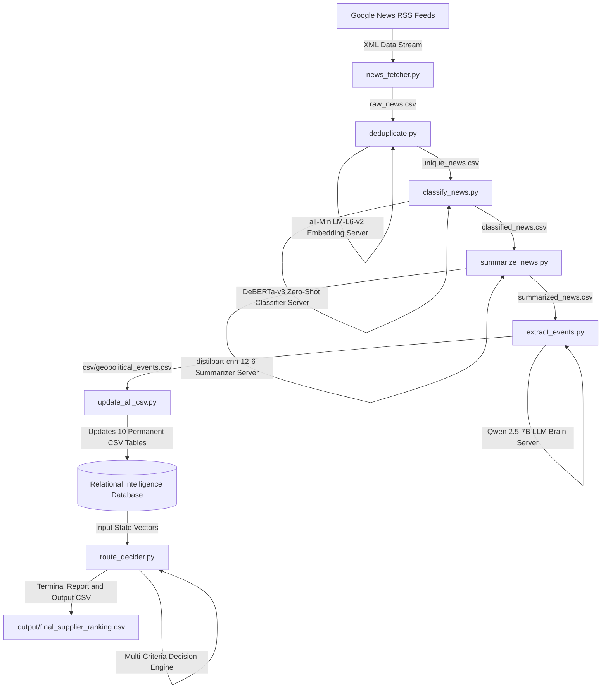
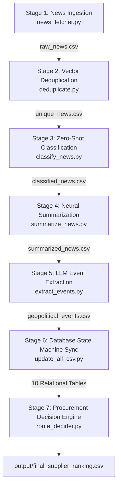

# AI-Driven Energy Supply Chain Resilience for Import-Dependent Economies

## 1. Executive Summary and Problem Context

India imports approximately 88% of its domestic crude oil demand, with 40% to 45% of that maritime volume transiting directly through the Strait of Hormuz. This heavy geographic concentration exposes the nation to extreme geopolitical vulnerabilities, including regional conflicts, state-sponsored maritime interdictions, drone assaults on tanker lanes, and logistical blockades across critical chokepoints such as the Strait of Hormuz, Bab el-Mandeb, and the Red Sea.

With India Strategic Petroleum Reserves (SPR) holding roughly 9.5 days of net national consumption cover, any prolonged supply disruption represents an immediate threat to industrial stability, transportation networks, and macroeconomic equilibrium. Supply chain resilience research indicates that import-dependent economies lacking automated rerouting and dynamic procurement intelligence take an average of 47 days longer to stabilize supply operations during maritime crises compared to organizations equipped with integrated algorithmic decision systems.

This repository implements an autonomous, AI-driven decision intelligence system engineered to:
1. Continuously monitor and ingest real-time geopolitical, energy market, and maritime shipping news feeds.
2. Filter, deduplicate, categorize, summarize, and extract structured crisis events through a four-stage neural pipeline.
3. Maintain an active relational state machine tracking conflict levels, trade sanctions, port security ratings, and maritime chokepoint transit requirements across global crude oil suppliers.
4. Execute a Multi-Criteria Procurement Decision Engine that combines live spot crude prices, tanker freight costs, risk-adjusted maritime insurance premiums, and geopolitical stability ratings to generate rank-ordered supplier recommendations and cargo financial sizing.
5. Operate over a zero-marginal-cost distributed infrastructure using free Google Colab T4 GPU runtimes and secure Cloudflare Tunnels for model inference, coordinated by a local Python execution engine.

For complete architectural specifications, system sequence diagrams, and mathematical proofs, refer to [ARCHITECTURE.md](ARCHITECTURE.md).

---

## 2. High-Level System Architecture and Pipeline Flowcharts

The system ingests raw external signals and progressively transforms them into structured geopolitical intelligence and optimized procurement actions.



### End-to-End Pipeline Stage Flow



---

## 3. Repository Directory Structure

```
AI-Driven-Energy-Supply-Chain-Resilience/
├── ARCHITECTURE.md                  # Comprehensive architectural specifications, schemas, and diagrams
├── README.md                        # Primary project documentation and operating guide
├── main.py                          # Master pipeline orchestrator executing all processing stages
├── news_fetcher.py                  # Ingestion engine for Google News RSS feeds with keyword filtering
├── deduplicate.py                   # Semantic deduplication using dense vector embeddings (cosine >= 0.90)
├── classify_news.py                 # Multi-threaded zero-shot event classifier (DeBERTa-v3)
├── summarize_news.py                # Multi-threaded neural text summarization (DistilBART)
├── extract_events.py                # Structured intelligence extraction engine (Qwen 2.5-7B)
├── update_all_csv.py                # Relational state machine updater and preference score synthesizer
├── route_decider.py                 # Multi-criteria decision engine, pricing, shipping, and insurance
├── raw_news.csv                     # Pipeline intermediate: Ingested raw news articles
├── unique_news.csv                  # Pipeline intermediate: Semantically deduplicated news items
├── classified_news.csv              # Pipeline intermediate: Categorized and filtered news articles
├── summarized_news.csv              # Pipeline intermediate: Compressed news summaries
│
├── csv/                             # Permanent Relational Intelligence Database (10 Stateful Tables)
│   ├── chokepoint_dependency.csv    # Maritime chokepoint transit requirements per exporting nation
│   ├── conflict_status.csv          # War, civil war, terror risk, and internal stability metrics
│   ├── diplomatic_risk.csv          # Political, export, and government stability ratings
│   ├── exporters.csv                # Baseline exporter profiles, capacities, crude grades, and trade links
│   ├── geopolitical_events.csv      # Persistent audit log of extracted crisis events
│   ├── geopolitical_relation.csv    # Bilateral diplomatic alignment scores (India, USA, Iran, etc.)
│   ├── port_security.csv            # Terminal-level operational status, military threats, and blockades
│   ├── sanctions.csv                # International trade sanctions, imposing authorities, and severity
│   ├── supplier_dependency.csv      # Indian import percentages and supplier spare production capacities
│   └── supplier_preference.csv      # Dynamic risk ratings and calculated supplier preference scores
│
├── Model/                           # Local API client wrappers connecting to Cloudflare endpoints
│   ├── __init__.py                  # Python package initialization
│   ├── classifier.py                # Client wrapper for DeBERTa-v3 Zero-Shot Classifier
│   ├── embedding.py                 # Client wrapper for all-MiniLM-L6-v2 Embedding Server
│   ├── qwen.py                      # Client wrapper for Qwen 2.5-7B-Instruct LLM Brain
│   └── summarizer.py                # Client wrapper for DistilBART-CNN-12-6 Summarizer
│
├── External_Server_run_on_colab/    # Google Colab GPU server notebooks (FastAPI + Cloudflare)
│   ├── classifier.ipynb             # DeBERTa-v3 zero-shot classification server notebook
│   ├── embedding.ipynb              # all-MiniLM-L6-v2 sentence embedding server notebook
│   ├── LLM.ipynb                    # Qwen 2.5-7B-Instruct generative LLM server notebook
│   └── sumarize.ipynb               # DistilBART text summarization server notebook
│
└── output/                          # Decision Engine Output Artifacts
    └── final_supplier_ranking.csv   # Final ranked supplier list with delivered prices and scores
```

---

## 4. Machine Learning and Model Hierarchy

To deliver high-throughput neural inference without reliance on paid commercial APIs, the architecture delegates compute across 4 specialized models hosted on free-tier Google Colab T4 GPU instances:

| Role | Model Identifier | Parameter Count | Architecture / Purpose | Hosting Runtime |
| :--- | :--- | :--- | :--- | :--- |
| Embedding Server | sentence-transformers/all-MiniLM-L6-v2 | 22M Parameters | 384-dimensional dense semantic vectors for cosine deduplication | Google Colab (T4 GPU) |
| Classifier Server | MoritzLaurer/DeBERTa-v3-base-mnli-fever-anli | 86M Parameters | Zero-shot classification across 15 supply chain disruption classes | Google Colab (T4 GPU) |
| Summarizer Server | sshleifer/distilbart-cnn-12-6 | 306M Parameters | Compresses noisy article bodies into 1-2 sentence factual briefs | Google Colab (T4 GPU) |
| LLM Brain Server | Qwen/Qwen2.5-7B-Instruct | 7 Billion Parameters | Structured 12-parameter JSON entity extraction from briefs | Google Colab (T4 GPU) |

### Server-Side Implementation Pattern

Each Colab notebook in `External_Server_run_on_colab/` instantiates a lightweight FastAPI application exposing a `/chat` endpoint:

```python
from fastapi import FastAPI
from pydantic import BaseModel
import uvicorn

app = FastAPI()

class ChatRequest(BaseModel):
    message: str

@app.post("/chat")
def process(request: ChatRequest):
    # Perform GPU-accelerated model inference
    return {"response": result}
```

A background subprocess launches a Cloudflare Tunnel:
```bash
!cloudflared tunnel --url http://127.0.0.1:8000
```
This generates a secure public ingress URL (such as `https://<tunnel-id>.trycloudflare.com`) that local client wrappers in `Model/` query over standard HTTPS.

---

## 5. End-to-End Technical Workflow

### 5.1. News Ingestion (news_fetcher.py)
- Queries 8 Google News RSS feeds covering critical geopolitical hot zones and commodity themes:
  - Strait of Hormuz oil
  - Iran oil tanker
  - Red Sea shipping attack
  - OPEC oil production
  - Saudi crude oil export
  - Russia oil sanctions
  - Global energy supply crisis
  - Iran Israel oil conflict
- Parses XML payloads using feedparser, strips raw HTML markup with BeautifulSoup, and normalizes whitespaces.
- Enforces an energy domain relevance filter checking for 27 key vocabulary tokens: crude, tanker, hormuz, strait, red sea, houthi, iran, israel, russia, sanction, pipeline, refinery, opec, brent, supply, barrel, export, import, shipping, chokepoint, fujairah, ras tanura, blockade, drone attack, missile, cargo, oil.
- Performs initial title-based deduplication and persists results to `raw_news.csv`.

### 5.2. Semantic Vector Deduplication (deduplicate.py)
- Transmits raw article text to the `sentence-transformers/all-MiniLM-L6-v2` embedding server.
- Receives 384-dimensional dense semantic vectors and constructs a pairwise cosine similarity matrix.
- Articles with similarity scores of 0.90 or higher are identified as duplicate coverage of the same event.
- Retains the longer, more detailed article body to preserve contextual information and writes deduplicated feeds to `unique_news.csv`.

### 5.3. Zero-Shot Event Classification (classify_news.py)
- Distributes deduplicated articles across a ThreadPoolExecutor with 10 concurrent workers querying the `DeBERTa-v3` zero-shot classification endpoint.
- Classifies article content against 15 predefined disruption labels:
  - Military Attack
  - Shipping Attack
  - Sanctions
  - Political Instability
  - Port Closure
  - Oil Production Cut
  - Oil Production Increase
  - Trade Agreement
  - Diplomatic Meeting
  - Natural Disaster
  - Cyber Attack
  - Pipeline Damage
  - Port Congestion
  - Oil Export Restriction
  - Other
- Discards articles where the highest prediction confidence is below 0.45 or classified as Other.
- Writes prioritized articles to `classified_news.csv`.

### 5.4. Neural Text Summarization (summarize_news.py)
- Dispatches classified articles via ThreadPoolExecutor with 6 concurrent workers to the `sshleifer/distilbart-cnn-12-6` summarization endpoint.
- Compresses unstructured reporting into dense 1-2 sentence factual abstracts.
- Drastically reduces token payload size, preventing context window bloat and decreasing latency for downstream LLM reasoning.
- Saves summarized briefs to `summarized_news.csv`.

### 5.5. Structured Intelligence Extraction (extract_events.py)
- Transmits summarized briefs to `Qwen 2.5-7B-Instruct` accompanied by a strict zero-shot entity extraction instruction.
- Generates a 12-parameter structured JSON document:
  - country: Sovereign jurisdiction where the crisis occurred
  - actor: Entity or group initiating the action (such as naval forces, militia, government)
  - event_type: Disruption class matching pipeline taxonomy
  - severity: Disruption magnitude rated on an integer scale from 0 to 5
  - political_risk: Country-level political instability impact (0 to 5)
  - export_risk: Operational threat to crude production or export flows (0 to 5)
  - india_affected: Boolean flag indicating direct risk to Indian imports
  - affected_exporters: Array of oil exporting nations directly or indirectly impacted
  - affected_ports: Specific marine terminals facing disruption
  - affected_chokepoints: Strategic waterways compromised (such as Strait of Hormuz, Bab el-Mandeb, Suez Canal)
  - sanction: Boolean flag for economic or trade sanctions
  - reason: Concise situational explanation (under 30 words)
- Employs regex sanitization to extract JSON bodies safely, bypassing markdown conversational fences, and records entries to `csv/geopolitical_events.csv`.

### 5.6. Relational Database State Synchronization (update_all_csv.py)
- Reads newly recorded incidents from `csv/geopolitical_events.csv` and initiates automated state transitions across 10 permanent database tables.
- Updates conflict flags (War, Civil War, Terror Risk), sanction statuses, port blockades, and chokepoint transit vulnerabilities.
- Executes the dynamic Supplier Preference Scoring algorithm combining baseline stability, diplomatic alignment, spare capacities, chokepoint bypass capability, and recent event penalties.

### 5.7. Procurement Decision Engine (route_decider.py)
- Ingests updated database state vectors and executes four analytical sub-engines:
  - Oil Price Engine: Fetches live Brent crude spot prices from Alpha Vantage and applies country crude grade quality differentials.
  - Shipping Route Engine: Maps export terminals to Mumbai, assigning shipping costs and Route Safety scores.
  - Insurance Engine: Computes risk-adjusted cargo insurance premiums covering war risks, terror threats, sanctions, and chokepoint hazards.
  - Multi-Criteria Decision Engine: Computes weighted scores across 8 operational criteria and applies immediate event deductions.
- Produces rank-ordered supplier recommendations in `output/final_supplier_ranking.csv` and displays volumetric financial analysis for 100K, 1M, and 100M barrel cargo contracts.

---

## 6. Relational Intelligence Database: CSV Data Dictionary

The platform maintains 10 stateful permanent relational tables in `csv/` and 4 temporary pipeline execution files in the project root:

### 6.1. Permanent Knowledge Tables (`csv/`)

1. `csv/geopolitical_events.csv`
- Primary audit ledger storing every structured event extracted from live news feeds.
- Schema: country, actor, event_type, severity, political_risk, export_risk, india_affected, affected_exporters, affected_ports, affected_chokepoints, sanction, reason, title, published, link, summary.

2. `csv/supplier_preference.csv`
- Central state machine tracking supplier operational risks and calculated composite preference scores.
- Schema: Country, Preference Score, Political Risk, Sanction Risk, Conflict Risk, Export Stability, Port Risk, Chokepoint Risk, Confidence.

3. `csv/sanctions.csv`
- Sovereign and institutional trade sanctions tracking.
- Schema: Country, Sanctioned (Yes/No), By Whom (imposing body), Severity (Low/Medium/High/Very High), Active (Yes/No).

4. `csv/port_security.csv`
- Terminal-level security, military threat, and blockade tracking for key global export ports.
- Schema: Port, Country, Risk (Low to Very High), Military Threat (Low to Very High), Blocked (Yes/Partial/No), Sanctions (Yes/No).

5. `csv/conflict_status.csv`
- National security indicators and armed conflict tracking.
- Schema: Country, War (Yes/No), Civil War (Yes/No), Internal Stability (Very Low to High), Terror Risk (Low to Very High).

6. `csv/diplomatic_risk.csv`
- Core institutional stability and governance indicators.
- Schema: Country, Political Stability (Very Low to High), Export Stability (Very Low to High), Government Stability (Very Low to High).

7. `csv/chokepoint_dependency.csv`
- Maritime waterway transit requirements for shipments bound for the Port of Mumbai.
- Schema: Country, Hormuz (Yes/Partial/No), Red Sea (Yes/Partial/No), Suez (Yes/Partial/No), Bab-el-Mandeb (Yes/Partial/No), Cape Route (Yes/No).

8. `csv/geopolitical_relation.csv`
- Quantitative indices of bilateral diplomatic relations with India and key global powers.
- Schema: Country, Relation with India (0 to 100), Relation with USA (0 to 100), Relation with Iran (0 to 100), Relation Score (0 to 100).

9. `csv/exporters.csv`
- Baseline logistical parameters, production rates, benchmark grades, and current supply links.
- Schema: Country, Export Capacity (bpd), Production (bpd), OPEC (Yes/No), OPEC Plus (Yes/No), Crude Grade, Current Export to India (High/Medium/Low/Spot), Strategic Notes.

10. `csv/supplier_dependency.csv`
- Indian national import reliance and available supplier production expansion capacity.
- Schema: Country, India Import Percentage, Can Increase Export (Yes/No), Spare Capacity (mbpd).

### 6.2. Temporary Execution Files

1. `raw_news.csv`: Filtered articles ingested from Google News RSS feeds matching domain keywords.
2. `unique_news.csv`: Cleaned articles retained after semantic vector cosine deduplication.
3. `classified_news.csv`: Articles assigned valid disruption categories meeting confidence thresholds.
4. `summarized_news.csv`: Condensed 1-2 sentence factual abstracts prepared for LLM extraction.

---

## 7. Mathematical Decision Engine and Scoring Formulations

### 7.1. Oil Price Sub-Engine
Queries real-time Brent crude spot price P_Brent through Alpha Vantage API (fallback default: 78.40 dollars per barrel). Calculates exporter Base Oil Price P_base using quality differentials delta_country:

```
P_base = P_Brent + delta_country
```

Grade Quality Differentials Schedule:
- Russia: -3.00 dollars (Urals heavy and sour blend)
- Canada: -2.00 dollars (Western Canadian Select)
- Iraq: -0.90 dollars (Basrah Medium)
- Kuwait: -0.50 dollars (Kuwait Export Crude)
- Saudi Arabia: -0.40 dollars (Arab Light)
- Oman: +0.10 dollars (Oman Blend)
- UAE: +0.20 dollars (Murban light sweet)
- Qatar: +0.30 dollars (Qatar Marine)
- United States: +1.50 dollars (WTI Midland)
- Brazil: +1.80 dollars (Lula / Tupi Blend)
- Nigeria: +2.00 dollars (Bonny Light sweet)
- Norway: +2.50 dollars (Johan Sverdrup / Brent blend)

Base Oil Price is inversely normalized to generate Price Score (lower price yields higher score):

```
Price Score = (1 - (P_base - min(P_base)) / (max(P_base) - min(P_base))) x 100
```

### 7.2. Shipping Route Sub-Engine
Assigns baseline freight costs per barrel based on maritime route distance to Mumbai (ranging from 1.90 dollars per barrel for UAE to 7.20 dollars per barrel for United States). Evaluates Route Safety:

```
Route Safety = clamp(100 - (12 x H) - (10 x RS) - (8 x BM) - (6 x SZ) + (3 x CR), 0, 100)
```

Where transit parameters evaluate to:
- H (Hormuz), RS (Red Sea), BM (Bab el-Mandeb), SZ (Suez): 1.0 for Yes, 0.5 for Partial, 0.0 for No
- CR (Cape Route): 1.0 for Yes, 0.0 for No

### 7.3. Insurance Sub-Engine
Calculates risk-adjusted cargo insurance premiums per barrel:

```
Insurance Premium = Base Insurance (0.80) + C_conflict + C_sanctions + C_port + C_chokepoint
```

Where:
- Base Insurance = 0.80 dollars per barrel
- C_conflict = 0.60 dollars (War) + 0.50 dollars (Civil War) + C_terror (0.40 Very High, 0.30 High, 0.15 Medium, 0.05 Low)
- C_sanctions = 0.40 dollars (if active trade sanctions exist)
- C_port = 0.40 dollars (Blocked Port) or 0.20 dollars (Partially Blocked Port)
- C_chokepoint = (0.30 x H) + (0.25 x RS) + (0.25 x BM) + (0.20 x SZ)

Total Delivered Price combines all physical procurement components:

```
Delivered Price = Base Oil Price + Shipping Cost + Insurance Premium
```

Delivered Price Score is inversely normalized (lower landed cost yields higher score).

### 7.4. Multi-Criteria Final Scoring Formulation
Computes the weighted multi-attribute final score across 8 strategic dimensions:

```
Final Score = (0.40 x Preference) + (0.20 x Delivered Price) + (0.15 x Route Safety) + (0.10 x Insurance) + (0.05 x Shipping) + (0.04 x Political) + (0.03 x Export) + (0.03 x Government) - Event Penalty
```

Criteria Weight Allocation:
- Preference Score: 40% (Geopolitical alignment, spare capacity, chokepoint resilience)
- Delivered Price Score: 20% (Landed cost per barrel)
- Route Safety Score: 15% (Chokepoint bypass and maritime lane security)
- Insurance Score: 10% (Risk premium minimization)
- Shipping Score: 5% (Freight transit rate efficiency)
- Political Stability Score: 4% (Institutional sovereign stability)
- Export Stability Score: 3% (Production continuity rating)
- Government Stability Score: 3% (Regime and administrative consistency)

Immediate Event Penalty Schedule:
- Maximum event severity >= 5: -20 points deduction
- Maximum event severity == 4: -15 points deduction
- Maximum event severity == 3: -8 points deduction
- Maximum event severity == 2: -4 points deduction
- Maximum event severity < 2: 0 points deduction

Exporters are ranked in descending order of Final Score. The highest-ranked nation is selected as the optimal alternative procurement partner.

---

## 8. Installation, Configuration, and Execution Guide

### 8.1. Prerequisites
- Python 3.9 or higher
- Git
- Google account with access to Google Colab (free T4 GPU runtime)

### 8.2. Installation
Clone the project repository and install required Python packages:

```powershell
git clone https://github.com/kajaredhruv433/AI-Driven-Energy-Supply-Chain-Resilience.git
cd AI-Driven-Energy-Supply-Chain-Resilience
pip install pandas numpy requests beautifulsoup4 feedparser scikit-learn tqdm
```

### 8.3. Starting Model Servers on Google Colab
1. Upload notebooks from `External_Server_run_on_colab/` to Google Colab.
2. Select runtime type: T4 GPU (Navigate to Runtime > Change runtime type > T4 GPU).
3. Execute all cells in each server notebook:
   - embedding.ipynb (Sentence-Transformers Server)
   - classifier.ipynb (DeBERTa-v3 Classifier Server)
   - sumarize.ipynb (DistilBART Summarizer Server)
   - LLM.ipynb (Qwen 2.5-7B Extraction Server)
4. Copy the public Cloudflare tunnel ingress URL printed in each notebook console (such as `https://<tunnel-id>.trycloudflare.com`).

### 8.4. Configuring Local API Client Endpoints
Update the `API_URL` variable in each client wrapper under `Model/` with the corresponding Cloudflare tunnel URL, ensuring you append `/chat`:

- Model/embedding.py:
  ```python
  API_URL = "https://<embedding-tunnel-id>.trycloudflare.com/chat"
  ```
- Model/classifier.py:
  ```python
  API_URL = "https://<classifier-tunnel-id>.trycloudflare.com/chat"
  ```
- Model/summarizer.py:
  ```python
  API_URL = "https://<summarizer-tunnel-id>.trycloudflare.com/chat"
  ```
- Model/qwen.py:
  ```python
  API_URL = "https://<qwen-tunnel-id>.trycloudflare.com/chat"
  ```

### 8.5. Executing the Master Pipeline
Run the master orchestration script:

```powershell
python main.py
```

The system will ingest fresh news feeds, execute neural filtering, update database states, run the procurement decision engine, print comprehensive terminal reports, and save structured results to `output/final_supplier_ranking.csv`.

---

## 9. Sample Execution Output and Procurement Decision

```
================================================================================
AI POWERED GEOPOLITICAL ENERGY INTELLIGENCE SYSTEM
================================================================================

[1/6] Fetching News...
Unique Relevant Articles : 42

[2/6] Removing Duplicates...
Original : 42 | Unique : 31 | Removed : 11

[3/6] Classifying News...
Articles after Classification : 28

[4/6] Summarizing Articles...
Articles Summarized : 28

[5/6] Extracting Events...
Events Extracted : 28

[6/7] Updating Intelligence Database...
Calculating Geopolitical Supplier Preference Scores using multi-factor formula...

[7/7] Running Procurement Decision Engine...
Brent Price : $78.40/barrel

After Oil Price Engine
         Country  Base Oil Price  Price Score
0   Saudi Arabia           78.00        63.64
1            UAE           78.60        52.73
2           Iraq           77.50        72.73
3         Kuwait           77.90        65.45
4        Nigeria           80.40        20.00

After Shipping Engine
         Country     Export Port                                              Route  Shipping Cost  Shipping Score  Route Safety
0   Saudi Arabia      Ras Tanura  Ras Tanura -> Strait of Hormuz -> Arabian Sea -...           2.10           96.23         88.00
1            UAE        Fujairah                   Fujairah -> Arabian Sea -> Mumbai           1.90          100.00         94.00
2           Iraq       Al Basrah   Al Basrah -> Strait of Hormuz -> Arabian Sea -...           2.40           90.57         88.00
3         Kuwait  Mina Al Ahmadi  Mina Al Ahmadi -> Strait of Hormuz -> Arabia...           2.00           98.11         88.00
4        Nigeria  Bonny Terminal        Bonny Terminal -> Cape of Good Hope -> Mumbai           4.80           45.28        100.00

After Insurance Engine
         Country  Insurance  Delivered Price  Insurance Score  Delivered Price Score
0   Saudi Arabia       1.10            81.20            86.36                  73.08
1            UAE       0.80            81.30           100.00                  71.79
2           Iraq       1.10            81.00            86.36                  75.64
3         Kuwait       1.10            81.00            86.36                  75.64
4        Nigeria       0.80            86.00           100.00                  11.54

========================================================================================================================
FINAL SUPPLIER RANKING
========================================================================================================================
    Rank       Country  Final Score  Delivered Price                                              Route     Export Port
0      1           UAE        84.65            81.30                 Fujairah -> Arabian Sea -> Mumbai        Fujairah
1      2  Saudi Arabia        79.42            81.20  Ras Tanura -> Strait of Hormuz -> Arabian Sea -...      Ras Tanura
2      3          Oman        78.91            81.30             Mina Al Fahal -> Arabian Sea -> Mumbai   Mina Al Fahal
3      4        Kuwait        76.53            81.00  Mina Al Ahmadi -> Strait of Hormuz -> Arabia...  Mina Al Ahmadi
4      5       Nigeria        72.18            86.00      Bonny Terminal -> Cape of Good Hope -> Mumbai  Bonny Terminal

================================================================================
FINAL PROCUREMENT DECISION
================================================================================
Supplier         : UAE
Export Port      : Fujairah
Shipping Route   : Fujairah -> Arabian Sea -> Mumbai
Delivered Price  : $81.30 per barrel
Total Cost (100K bbl) : $8.13M
Total Cost (1M bbl)   : $81.30M
Total Cost (100M bbl) : $8.13B
Final Score      : 84.65
================================================================================
```

### Commercial Volumetric Financial Sizing Comparison

| Supplier | Delivered Price ($/bbl) | 100,000 Barrels (Aframax) | 1,000,000 Barrels (Suezmax) | 100,000,000 Barrels (Strategic Portfolio) | Route Resilience |
| :--- | :--- | :--- | :--- | :--- | :--- |
| UAE (Fujairah) | $81.30 | $8.13 Million | $81.30 Million | $8.13 Billion | Bypasses Strait of Hormuz completely |
| Saudi Arabia (Ras Tanura) | $81.20 | $8.12 Million | $81.20 Million | $8.12 Billion | High Hormuz transit vulnerability |
| Iraq (Al Basrah) | $81.00 | $8.10 Million | $81.00 Million | $8.10 Billion | High Hormuz vulnerability and spot cancellations |
| Kuwait (Mina Al Ahmadi) | $81.00 | $8.10 Million | $81.00 Million | $8.10 Billion | Total Hormuz dependency |
| Nigeria (Bonny Terminal) | $86.00 | $8.60 Million | $86.00 Million | $8.60 Billion | Cape Route bypasses all Middle East straits |

---

## 10. Technology Stack and Tooling

- Core Language: Python 3.9+
- Natural Language Processing and Neural Models:
  - Qwen/Qwen2.5-7B-Instruct (Zero-Shot Structured Entity Extraction)
  - MoritzLaurer/DeBERTa-v3-base-mnli-fever-anli (Zero-Shot Text Classification)
  - sshleifer/distilbart-cnn-12-6 (Neural Abstractive Summarization)
  - sentence-transformers/all-MiniLM-L6-v2 (Dense Semantic Vector Embeddings)
- Data Ingestion and ETL: Feedparser, BeautifulSoup4, Pandas, NumPy, Scikit-Learn
- Distributed Inference Infrastructure: FastAPI, Uvicorn, PyTorch, Hugging Face Transformers, Cloudflare Tunnels
- Commodity Market Data: Alpha Vantage Crude Oil API

---

## 11. Authors and Acknowledgments

Lead Developer:
- Dhruv Kajare

Team Members:
- Juhi Nale
- Neha Tarmale

Project Context:
Engineered for the INNOV8 3.0 Hackathon AI Geopolitical Decision Intelligence Initiative exploring autonomous neural intelligence pipelines, distributed zero-cost GPU inference, and multi-criteria mathematical optimization for national energy supply security.
